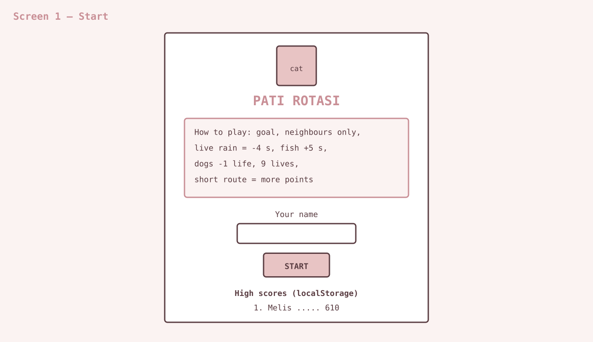
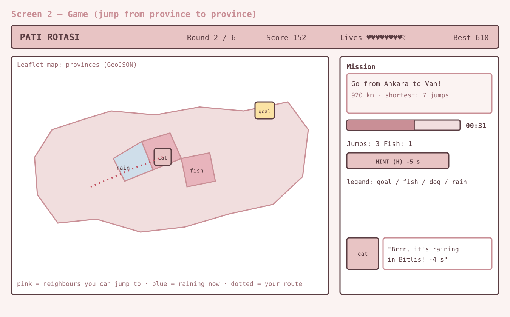
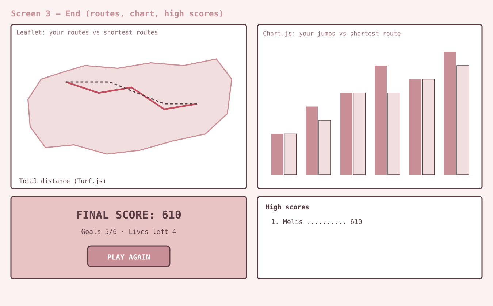

# Pati Rotası – a cat GeoGame 🐾🗺️

**GMT 458 Web GIS – Assignment 2**
Melis Nimet Kazan – Hacettepe University, Geomatics Engineering

🎮 **Play online:** _link will be added (GitHub Pages)_

🇹🇷 The game interface is in **Turkish**; this documentation is in English.

---

## 1. Game description

A little pixel cat travels across Turkey. In every round the cat gets a **goal province** (for example *"Your cousin, the Van cat, is waiting in Van!"*) and must reach it **before the time runs out**.

The rule that makes it a GeoGame: **the cat can only jump to a neighbouring province.** The player builds the route province by province on the map, so every move is a spatial decision:

- **Neighbourhood (topology):** only provinces that share a border with the current province can be clicked.
- **Shortest route:** the game knows the route with the fewest jumps (breadth-first search on the province graph). The closer the player's route is to it, the more points.
- **Live weather:** cats hate water! The game loads the **real, current weather of all 81 provinces** (Open-Meteo). Jumping into a province where it is raining or snowing right now costs extra time, so the best route on the map is not always the best route in reality.
- **Distance:** the straight-line distance to the goal and the total distance travelled are calculated with Turf.js.

## 2. Functional requirements

1. The player enters a name and starts the game.
2. The game loads the province borders, the neighbour list and the live weather of all 81 provinces.
3. Each round shows a start province (the cat), a goal province (🏠), fish (🐟), dogs (🐕) and rainy provinces (🌧️).
4. Provinces next to the cat are highlighted in pink (rounds 1–4). Clicking one makes the cat jump there (animation). Clicking a province that is too far (or closed by snow) shakes the map and shows a message.
5. A countdown timer runs. Fish add time, rainy provinces and hints remove time.
6. Dogs take one of the cat's **9 lives**.
7. When the cat reaches the goal, the round is scored and a result pop-up is shown. If the time runs out, the cat loses 2 lives.
8. After 6 rounds (or with 0 lives) the end screen shows all routes on a map, a chart of jumps per round and the high score list.
9. High scores are saved in the browser (`localStorage`).
10. If the weather service cannot be reached, the game still works with clearly marked demo rain.

## 3. Frontend layout (sketches)

**Screen 1 – Start**


**Screen 2 – Game**


**Screen 3 – End of game**


Style: **pixel art** sprites (cat, fish, dog, house, rain cloud), a **pixel font** and **dusty pink** colours – the same style as my personal web page.

## 4. Game progression

The game gets harder in three steps. Helps are switched off one by one, so in the last rounds the player really needs to know the map of Turkey.

| Rounds | Goal distance | Dogs / fish | Time | Helps and rules |
|---|---|---|---|---|
| 1 – 2 | 3–4 jumps | 3 / 3 | 6 s per jump + 8 s | Province names on hover, pink neighbours, length of the shortest route is shown |
| 3 – 4 | 5–7 jumps | 5 / 3 | (5 s per jump + 8 s) × 0.9 | **Names hidden**, shortest-route length hidden, **provinces where it is snowing now are closed** ❄️, **dogs walk** to a random neighbouring province after every jump |
| 5 – 6 | 7–10 jumps | 6 / 2 | (5 s per jump + 10 s) × 0.85 | + **no pink neighbour help**, **wrong click −4 s**, **dogs chase the cat** (60 % of their steps go towards the cat, using BFS distance) |

The goal of a round is the start of the next round, so the cat really travels across the country. Fish and dogs are placed near the useful corridor between start and goal (provinces where *jumps from start + jumps to goal ≤ shortest route + 2*). From round 3 the shortest route is calculated **around the closed (snowy) provinces**, so live snow can force a longer route.

## 5. Number of tasks

**6 rounds** (6 goal provinces) in one game.

## 6. Lives

The cat has **9 lives** ♥♥♥♥♥♥♥♥♥.
- A dog: −1 life (from round 3 the dogs walk – in rounds 5–6 they chase the cat – and a dog that walks into the cat's province also takes a life).
- Time runs out: −2 lives (the round is lost).
- 0 lives = game over.

## 7. Scoring and high score

For a successful round:

```
route points = 100 × (shortest route jumps / your jumps)
time points  = 2 × seconds left
```

A perfect route gives 100 route points; every extra jump lowers it. A lost round gives 0 points. The total of the 6 rounds is the final score. The **best 5 scores** (name + score) are saved in `localStorage`; the best score is always shown in the top bar.

## 8. Temporal component

- Every round has a countdown (longer for far goals, shorter in later rounds).
- **🐟 Fish: +5 s** · **🌧️ jump into a province where it is raining/snowing now: −5 s** · **💡 hint (H key): −8 s** · **❌ wrong click (rounds 5–6): −4 s**
- Time points reward fast players; when the time is over the cat loses 2 lives.
- The weather itself is time-dependent: it is loaded live when the game starts, so the same route can be good today and bad tomorrow.

## 9. JavaScript libraries

| Library | Use |
|---|---|
| **Leaflet** | Province map (GeoJSON), hover/click on provinces, sprites as markers, cat jump animation, route map at the end |
| **Turf.js** | Straight-line distance to the goal and total distance travelled (`turf.distance`) |
| **Chart.js** | End screen: your jumps vs. the shortest route for each round |

Fonts: *Press Start 2P* and *VT323* (Google Fonts).

## 10. Open data

| Data | Source |
|---|---|
| Province borders (GeoJSON) | [tr-geojson by cihadturhan](https://github.com/cihadturhan/tr-geojson) (coordinates rounded to make the file smaller) |
| Province neighbours + label points | `data/provinces.json`, built from the borders with `tools/build_adjacency.py` (Python + Shapely) |
| Live weather of 81 provinces | [Open-Meteo API](https://open-meteo.com/) – free, no API key, one request for all provinces |

## 11. Implementation

### 11.1 Event handlers

1. **Province click** (`js/map.js`): every province polygon has `layer.on("click", …)`. It calls `onProvinceClick(name)`, which checks if the province is a neighbour of the cat and then makes the cat jump (or shakes the map if it is too far).
2. **Province hover** (`mouseover` / `mouseout`): reachable provinces turn darker pink under the mouse and go back to their normal colour when the mouse leaves.
3. **Keyboard** (`keydown` on `document`): **Enter** starts the game, **H** asks for a hint (the next province on the shortest route turns green, −8 s), **Enter/Space** closes the round result pop-up.

Other handlers: START, HINT, NEXT ROUND and PLAY AGAIN buttons.

### 11.2 Closures

Most parts of the game are **factory functions**. Their variables are private; other code can only use the functions they return.

| Function | Private data |
|---|---|
| `createTimer()` (`js/timer.js`) | `remaining` seconds and the `intervalId`; `addTime()` lets fish/rain change the time safely |
| `createGraph()` (`js/graph.js`) | the neighbour list; `shortestPath()` (BFS, can avoid closed provinces) and `jumpsFrom()` use it |
| `createWeatherService()` (`js/weather.js`) | a `cache` with the weather of all provinces (loaded once per game) |
| `createGame()` (`js/game.js`) | the game state (round, score, lives, cat position, history); `getState()` returns only a copy |
| `createHighScores()` (`js/game.js`) | the `localStorage` key and the top-5 logic |
| `createCatMap()` (`js/map.js`) | the Leaflet map, layers, markers, the colour state of every province and which helps (names, pink highlight) are on |

Example – the timer:

```js
function createTimer(totalSeconds, onTick, onEnd) {
    let remaining = totalSeconds;   // private
    let intervalId = null;          // private
    function start() { /* setInterval: remaining -= 1 ... */ }
    function addTime(seconds) { remaining = Math.max(0, remaining + seconds); /* ... */ }
    function stop() { clearInterval(intervalId); }
    return { start, stop, addTime, getRemaining };
}
```

### 11.3 DOM interaction

- **Switching screens:** `classList.add/remove("active")` on the `<section>` elements.
- **Live values:** `textContent` updates round, score, lives (♥♡), jumps, fish and the timer text.
- **Timer bar:** `style.width` changes every second; `classList.toggle("danger")` makes it blink in the last 10 seconds.
- **Cat messages:** the speech bubble text and the cat picture (`img.src`: sitting / jumping / wet) change after every jump.
- **Pop-up:** the round result table is written with `innerHTML` and shown by removing the `hidden` class.
- **High score list:** `<li>` elements are created with `document.createElement()` and added with `appendChild()`.

## 12. What I learned from AI

_To be added (with the link to the conversation)._

## 13. Project structure

```
geogame/
├── index.html
├── css/style.css
├── js/
│   ├── timer.js       countdown timer (closure)
│   ├── weather.js     live weather of 81 provinces (Open-Meteo)
│   ├── graph.js       neighbours + shortest route (BFS)
│   ├── map.js         Leaflet map, cat, fish, dogs, routes
│   ├── game.js        rounds, lives, score, high scores
│   └── main.js        screens, event handlers, game loop
├── data/
│   ├── turkey-provinces.geojson
│   └── provinces.json         neighbours + label points
├── assets/sprites/    pixel art (cat, fish, dog, goal, rain, snow) – drawn with Claude
├── tools/build_adjacency.py
└── docs/              sketches for this README
```

## 14. How to run locally

Open the folder in VS Code and start **Live Server** (the game loads JSON files, so it needs a local server – double-clicking `index.html` does not work).
