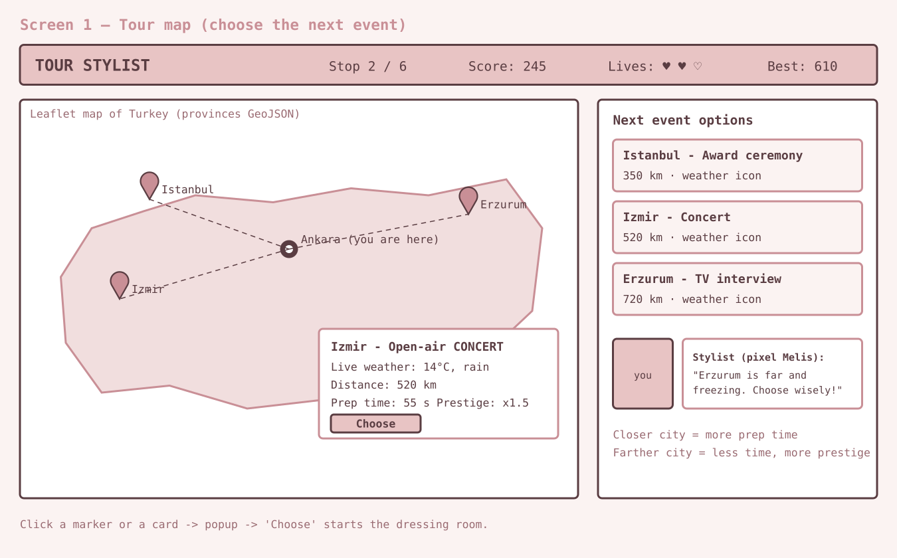
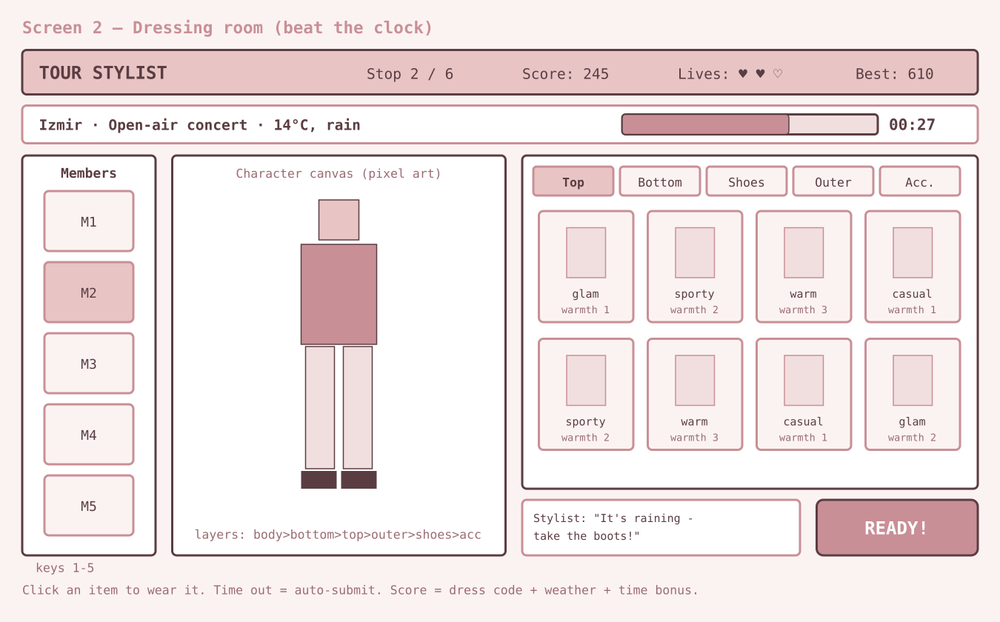
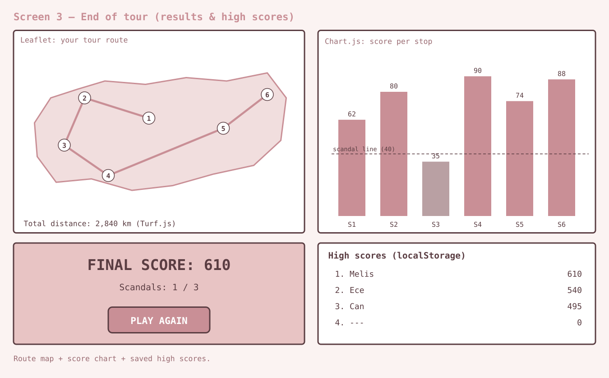

# Tour Stylist – a GeoGame 🎤🗺️

**GMT 458 Web GIS – Assignment 2**
Melis Nimet Kazan – Hacettepe University, Geomatics Engineering

🎮 **Play online:** _link will be added (GitHub Pages)_

> Fan-made, non-commercial student project inspired by the Turkish girl group **Manifest**.
> The character sprites are pixel fan art drawn by me.

---

## 1. Game description

You are the stylist of a girl group on a **concert tour across Turkey**.
Before every event, you choose **where the band goes next** on the map, and then you have a **limited time** to dress one member for that event.

Geography is the core of the game:

- **Location → event:** every city on the map hosts a different event (concert, award ceremony, TV interview, festival, airport arrival). Each event has its own dress code.
- **Location → live weather:** the game reads the **real, current weather** of the city (Open-Meteo API). A good outfit for İstanbul in the rain is a bad outfit for Antalya in the sun.
- **Distance → time:** the distance between your current city and the next city decides your **preparation time**. A far city gives you **less time**, but a **higher prestige** multiplier.

So every decision is spatial: *Which city? How far? What is the weather there?*

## 2. Functional requirements

1. The player can enter a name and start a new tour.
2. The game shows a map of Turkey with the current city and **3 event options**.
3. Clicking a marker (or an option card) opens a popup with: city, event type, live weather, distance and preparation time.
4. The player chooses one event; the band "travels" there and the **dressing room** opens.
5. A **countdown timer** starts. The player picks a band member and clothes (top, bottom, shoes, outerwear, accessory).
6. Clothes are drawn on the character as **pixel-art layers**.
7. When the player clicks **READY!** (or the time runs out), the outfit is scored.
8. If the score is too low, the player loses a life (a "scandal").
9. After 6 stops (or 0 lives) the tour ends: the route is drawn on the map, the scores are shown in a chart, and the high score list is updated.
10. High scores are saved in the browser (`localStorage`).
11. If the weather API does not answer, the game uses a backup value (average temperature for that month).

## 3. Frontend layout (sketches)

**Screen 1 – Tour map:** choose the next event.


**Screen 2 – Dressing room:** dress a member before the time runs out.


**Screen 3 – End of tour:** route, score chart and high scores.


The design uses the same style as my personal web page: **pixel art**, a **pixel font** and **dusty pink** colours.

## 4. Game progression

A tour has **6 stops**. The game gets harder step by step:

| Stops | What changes |
|---|---|
| 1 – 2 | Normal preparation time. Only dress code and weather are scored. |
| 3 – 4 | Preparation time × 0.85. A **member request** appears (e.g. *"M3 wants something pink"*). |
| 5 – 6 | Preparation time × 0.70. Events are **at night**, so the game uses the evening temperature (colder). |

## 5. Number of tasks

- **6 stops** (tasks) in one tour.
- At each stop the player chooses **1 of 3** events. The events come from a pool of **18 events in 12 cities**, so every tour is different.

## 6. Lives

- The player has **3 lives** (♥ ♥ ♥).
- If the base score of a stop is **below 40**, it is a **scandal** in the tabloids and the player loses 1 life.
- 0 lives = the tour is cancelled (game over).

## 7. Scoring and high score

Each item has **style tags** (glam, sporty, casual, stage, warm…), a **warmth** value (1–3), a **colour**, and some items are **waterproof**.

**Base score of a stop (max 100):**

| Part | Points | Rule |
|---|---|---|
| Dress code | 0 – 50 | +10 for each item whose tag fits the event (5 slots). |
| Weather | 0 – 30 | Total warmth must fit the real temperature. Rain/snow: a waterproof item is needed. |
| Time bonus | 0 – 20 | 20 × (remaining time / total time). |
| Member request | ±10 | Stops 3–6 only. |

Temperature → needed total warmth: ≥ 25 °C: 3–6 · 12–24 °C: 6–9 · 0–11 °C: 9–12 · below 0 °C: 12+.

**Final score of a stop = base score × prestige**

- Prestige by event: airport ×1.0 · TV interview ×1.1 · festival ×1.2 · concert ×1.3 · award ceremony ×1.5
- Distance bonus: +0.1 for every 250 km travelled.

**High score:** the best 5 scores (name + score) are saved in `localStorage`. The best score is always shown in the top bar.

## 8. Temporal component

Time is connected to **space**:

```
preparation time (s) = 90 − distance (km) / 15      (between 30 s and 80 s)
                       × stage factor (1.0 / 0.85 / 0.70)
```

Examples from Ankara: İstanbul (≈350 km) → 67 s · İzmir (≈520 km) → 55 s · Erzurum (≈720 km) → 42 s.

- A countdown bar shows the remaining time and changes colour in the last 10 seconds.
- Faster players get a bigger **time bonus**.
- When the time is over, the outfit is submitted automatically (empty slots get 0 points).
- The player must balance **near & safe** vs **far & prestigious** events.

## 9. JavaScript libraries

| Library | Use |
|---|---|
| **Leaflet** | Map of Turkey, event markers, popups, tour route line |
| **Chart.js** | Score-per-stop chart at the end of the tour |
| **Turf.js** | Distance between cities and total tour length |

Font: *Press Start 2P* (Google Fonts).

## 10. Open data

| Data | Source |
|---|---|
| Live weather (temperature, rain, weather code) | [Open-Meteo API](https://open-meteo.com/) – free, no API key |
| Turkey province borders (GeoJSON) | Open GeoJSON of Turkish provinces (source link will be added) |
| City coordinates | OpenStreetMap |

## 11. Implementation

_This part will be completed during development._

### 11.1 Three event handlers
_To be added._

### 11.2 Closures
_To be added._

### 11.3 DOM interaction
_To be added._

## 12. What I learned from AI

_To be added (with the link to the conversation)._

## 13. Project structure (plan)

```
geogame/
├── index.html
├── css/style.css
├── js/
│   ├── main.js        game flow
│   ├── map.js         Leaflet map, markers, route
│   ├── weather.js     Open-Meteo requests
│   ├── dressing.js    wardrobe and character layers
│   └── score.js       scoring and high scores
├── data/
│   ├── events.json    cities, events, coordinates
│   ├── items.json     clothes with tags and warmth
│   └── turkey.geojson
├── assets/sprites/    pixel art characters and clothes
└── docs/              sketches for this README
```
